# DSH Office 功能演示

[返回项目首页](../../README.md)

## 01 工作区入口

在右侧工作区点击 `.docx`、`.xlsx` 或 `.pptx` 文件即可打开。Office 沿用当前账号及目录授权。

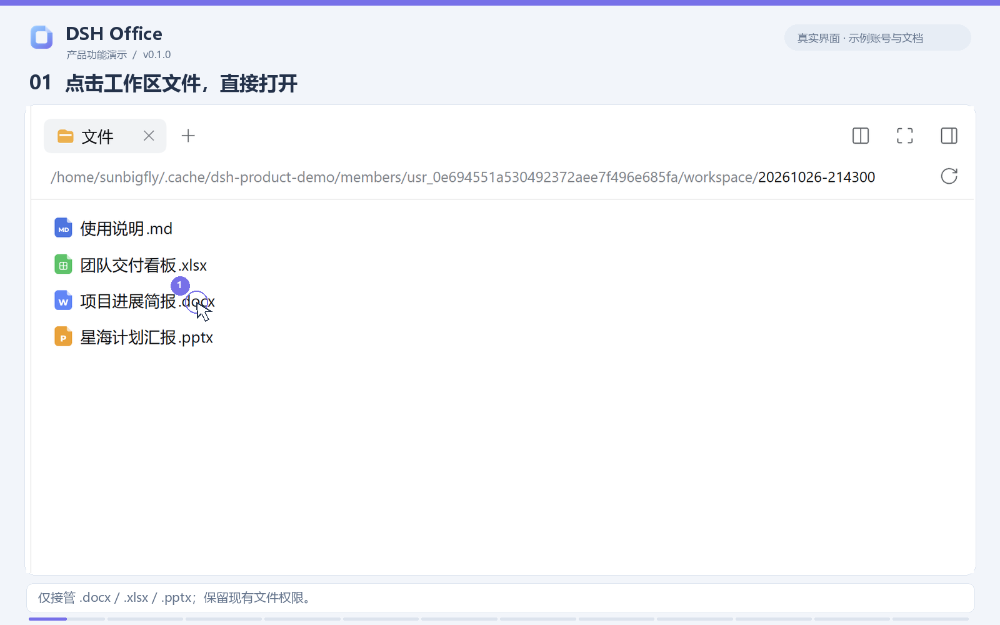

## 02-04 Word

默认进入预览。菜单保留在文档上方，切换编辑后使用文字、段落和表格等功能，点击“保存到工作区”写回原文件。保存前核对文件版本，冲突时拒绝覆盖并保留当前草稿。

预览、编辑、保存的实际效果

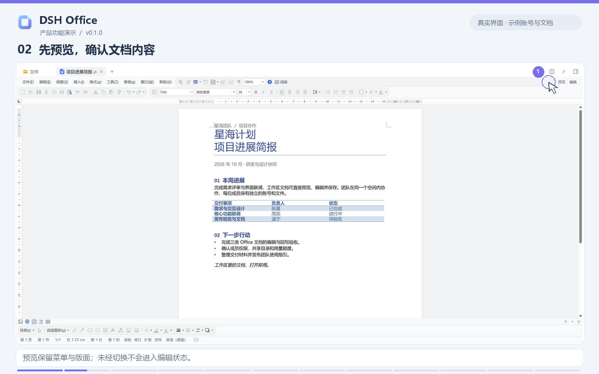

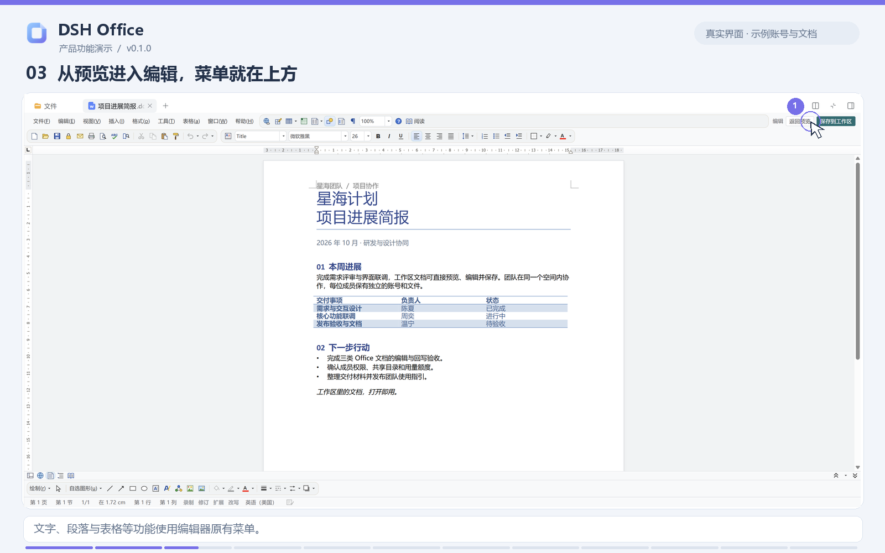

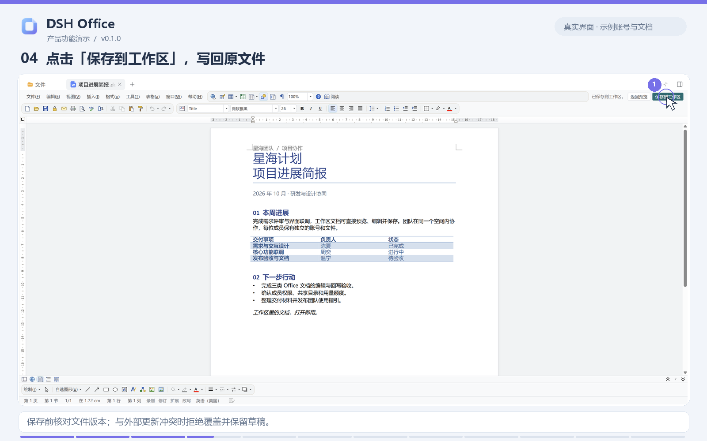

## 05-07 Excel

示例工作簿包含项目数据、单元格样式、百分比、汇总公式和工时图表。在侧栏切换编辑，完成后保存工作簿。

表格预览、编辑与保存

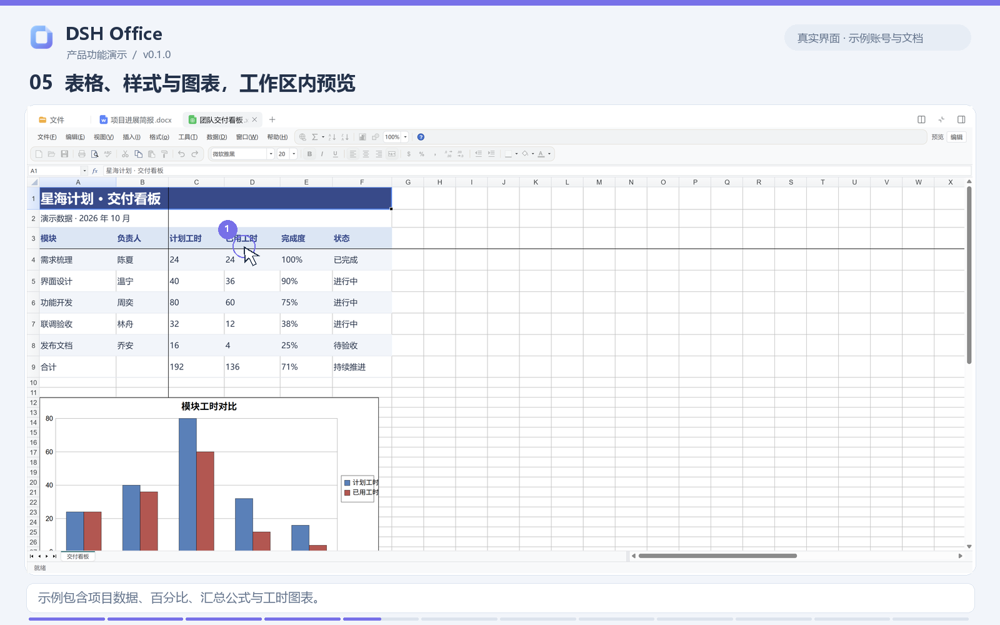

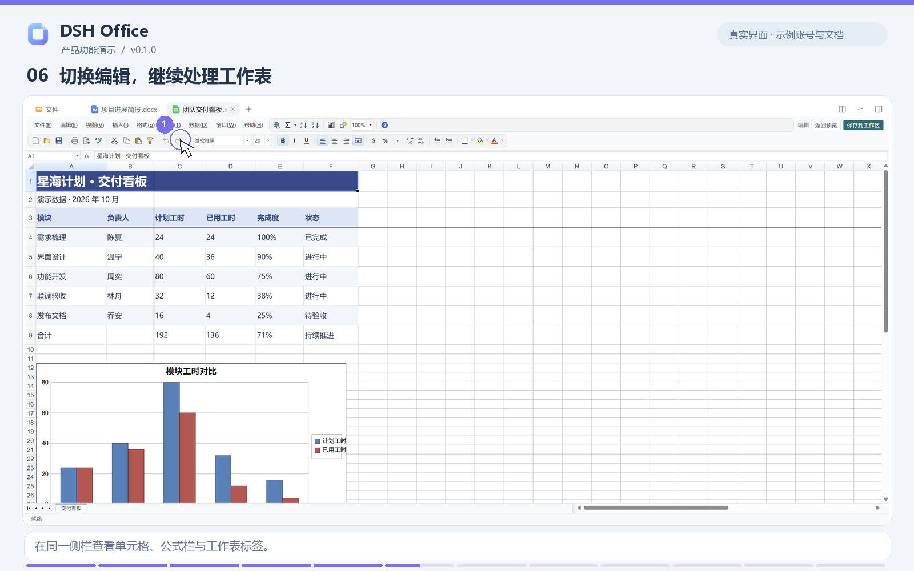

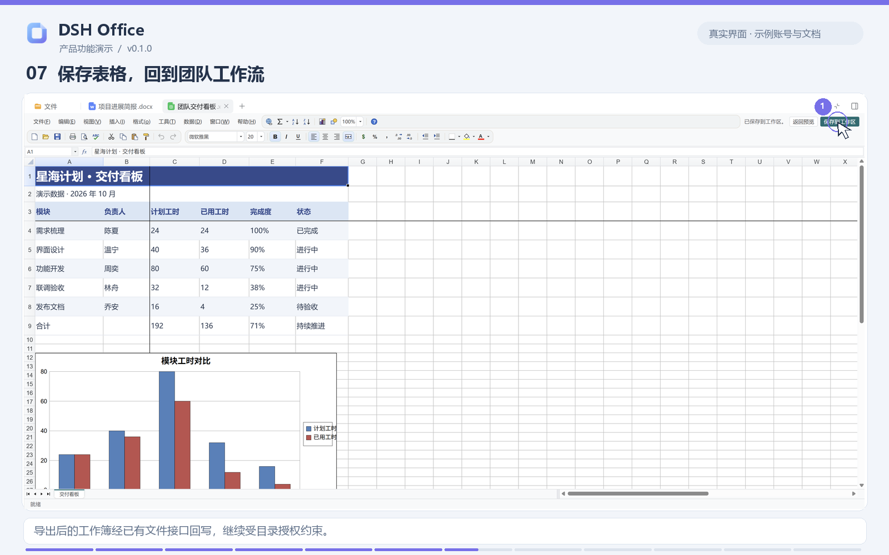

## 08-10 PowerPoint

通过缩略图和画布查看幻灯片，切换编辑后继续整理文本与图形，沿用同一套保存入口。

幻灯片预览、编辑与保存

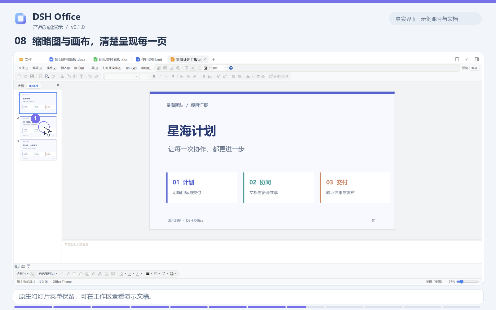

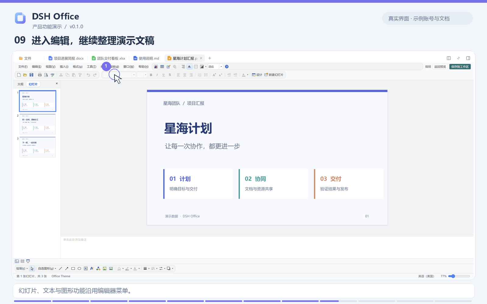

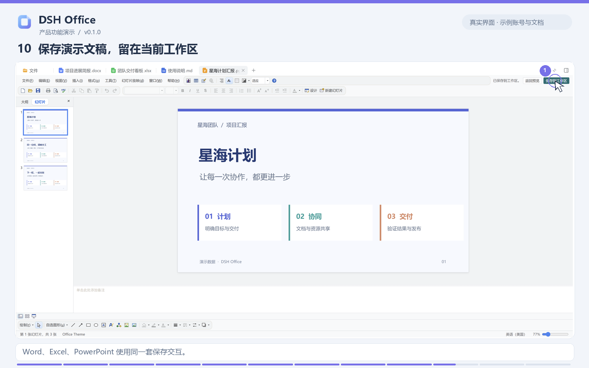

## 11 窄侧栏适配

以下放大展示三种编辑器在 **520 px 侧栏**中的实际菜单与工具栏：菜单空间不足时折叠，格式及绘图工具栏可横向滚动。三行分别来自独立打开的 Word、Excel 和 PowerPoint。宠物默认隐藏，需要时从帮助菜单打开。

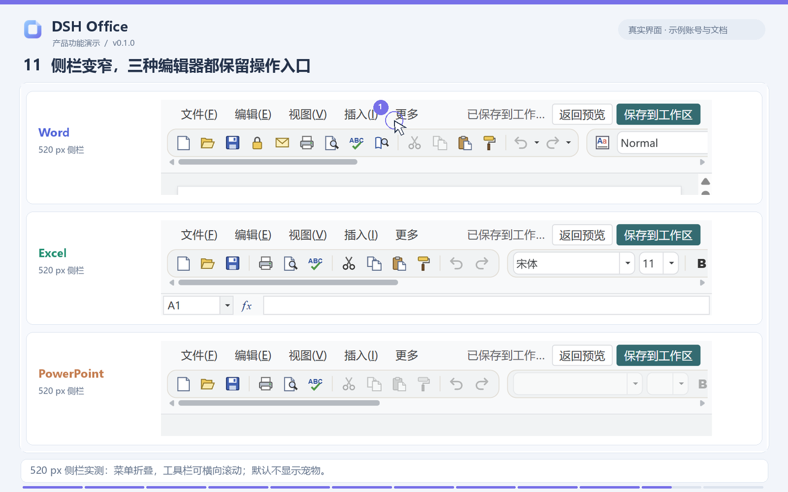

## 12 Markdown 原生打开

Markdown 不由 Office 接管，保持 DSH 原生查看方式。

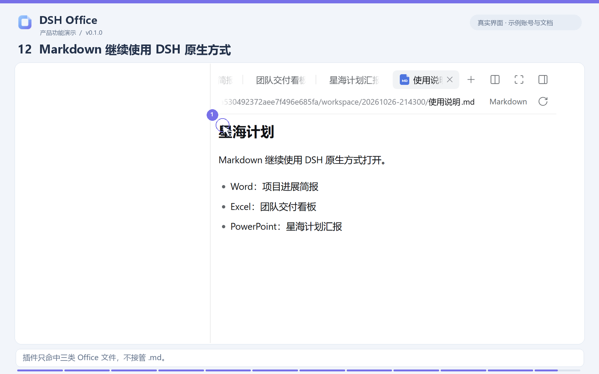

文档格式兼容性与文件权限说明见 [使用指南](../usage.md#文件和权限)。
